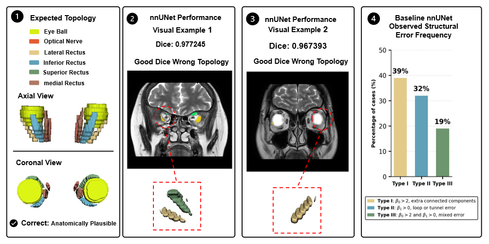
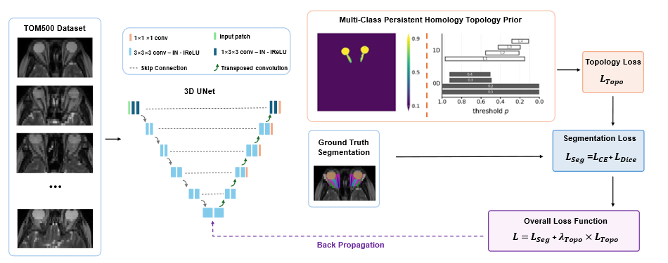

# Multi-Object Topology-Aware Anatomical Modeling for Consistent Orbital Segmentation

Code for our SPIE Medical Imaging abstract
**[Multi-object topology-aware anatomical modeling for consistent orbital segmentation](https://spie.org/medical-imaging/presentation/Multi-object-topology-aware-anatomical-modeling-for-consistent-orbital-segmentation/14518-48)** (Paper 14518-48, 2027).

Xiaoyue Liu, Zhenhan Lin, Adam M. Saunders, Gaurav Rudravaram, Isaac Bakis, Melissa Goldin,
Justin Shi, Louise A. Mawn, Bennett A. Landman — Vanderbilt University

Built on top of **[nnU-Net v2](https://github.com/MIC-DKFZ/nnUNet)** (v2.6.4).

## Problem



Each bilateral orbital structure (eyeballs, optic nerves, rectus muscles) should form exactly
**two connected components with no loops or cavities**, i.e. Betti numbers (β0, β1, β2) = (2, 0, 0).
Voxel-wise losses such as Dice and cross-entropy do not enforce this. Baseline nnU-Net therefore
can reach high Dice while producing anatomically implausible topology: extra components
(Type I), loops/tunnels (Type II), or both (Type III).

## Method



We add a multi-class **persistent-homology topology loss** to nnU-Net. For each anatomical prior
(SR, LR, MR, IR, optic nerve, eyeball, and the optic nerve + eyeball union), the class
probabilities are combined and persistent homology is computed. The loss keeps the features
required by the target Betti tuple (2, 0, 0) and penalizes all extra ones:

```
L = L_CE + L_Dice + λ_Topo · L_Topo
```

Main changes to nnU-Net:

- [`nnunetv2/training/loss/anatomical_prior.py`](anatomical_loss/nnUNet/nnunetv2/training/loss/anatomical_prior.py): topology loss (new)
- [`nnunetv2/training/nnUNetTrainer/nnUNetTrainer.py`](anatomical_loss/nnUNet/nnunetv2/training/nnUNetTrainer/nnUNetTrainer.py): adds `λ_Topo · L_Topo` to the training loss
- [`nnunetv2/training/logging/nnunet_logger.py`](anatomical_loss/nnUNet/nnunetv2/training/logging/nnunet_logger.py): logs the topology loss

## Usage

All commands are run from the repository root.

**Install** (Python ≥ 3.10; install [PyTorch](https://pytorch.org) for your CUDA version first)

```bash
pip install -e anatomical_loss/nnUNet
```

**Set nnU-Net paths**

```bash
export nnUNet_raw=/path/to/nnUNet_raw
export nnUNet_preprocessed=/path/to/nnUNet_preprocessed
export nnUNet_results=/path/to/nnUNet_results
```

**Prepare data** (e.g. TOM500, Zhang *et al.*, *Scientific Data*, 2025) in
[nnU-Net format](anatomical_loss/nnUNet/documentation/dataset_format.md), then:

```bash
nnUNetv2_plan_and_preprocess -d <DATASET_ID> --verify_dataset_integrity
```

**Train** — the topology loss is configured by `NNUNET_ANATOMICAL_CONFIG`:

```bash
# topology-aware model
export NNUNET_ANATOMICAL_CONFIG=$(realpath configs/anatomical_topology.json)
nnUNetv2_train <DATASET_ID> 3d_fullres <FOLD>

# baseline nnU-Net
export NNUNET_ANATOMICAL_CONFIG=$(realpath configs/baseline.json)
nnUNetv2_train <DATASET_ID> 3d_fullres <FOLD>
```

Models are trained for 350 epochs. In the topology-aware model, the first
`"topo_warmup_epochs"` (40) epochs use only the segmentation loss, to avoid unstable topology
regularization early in training; after that, the topology loss is added to the
segmentation loss. Label IDs follow TOM500
(SR=1, LR=2, MR=3, IR=4, ON=5, eyeball=9); edit `_build_prior_specs` in `anatomical_prior.py`
for other label maps.

**Predict** — unchanged from nnU-Net (`nnUNetv2_predict`).

## Citation

```bibtex
@inproceedings{liu2027topology,
  title     = {Multi-object topology-aware anatomical modeling for consistent orbital segmentation},
  author    = {Liu, Xiaoyue and Lin, Zhenhan and Saunders, Adam M. and Rudravaram, Gaurav and
               Bakis, Isaac and Goldin, Melissa and Shi, Justin and Mawn, Louise A. and
               Landman, Bennett A.},
  booktitle = {SPIE Medical Imaging},
  year      = {2027},
  note      = {Paper 14518-48, to appear},
  url       = {https://spie.org/medical-imaging/presentation/Multi-object-topology-aware-anatomical-modeling-for-consistent-orbital-segmentation/14518-48}
}
```

Please also cite [nnU-Net](https://github.com/MIC-DKFZ/nnUNet) (Isensee *et al.*, *Nature Methods*, 2021)
and the persistent-homology loss of Byrne *et al.* (*IEEE TMI*, 2022).

## Acknowledgements

We thank the authors of **[nnU-Net](https://github.com/MIC-DKFZ/nnUNet)** (Fabian Isensee and the
Division of Medical Image Computing, German Cancer Research Center (DKFZ), Heidelberg) for making
their code publicly available; this repository is built directly on their implementation.
We also thank:

- Byrne *et al.* for the multi-class persistent-homology topological loss that our anatomical
  topology loss is based on;
- the developers of **[CubicalRipser](https://github.com/shizuo-kaji/CubicalRipser_3dim)**, used to
  compute persistent homology;
- the creators of the **TOM500** dataset (Zhang *et al.*, *Scientific Data*, 2025) for making
  their annotated orbital MRI data publicly available.

## License

Apache License 2.0, same as nnU-Net. See [LICENSE](LICENSE).
